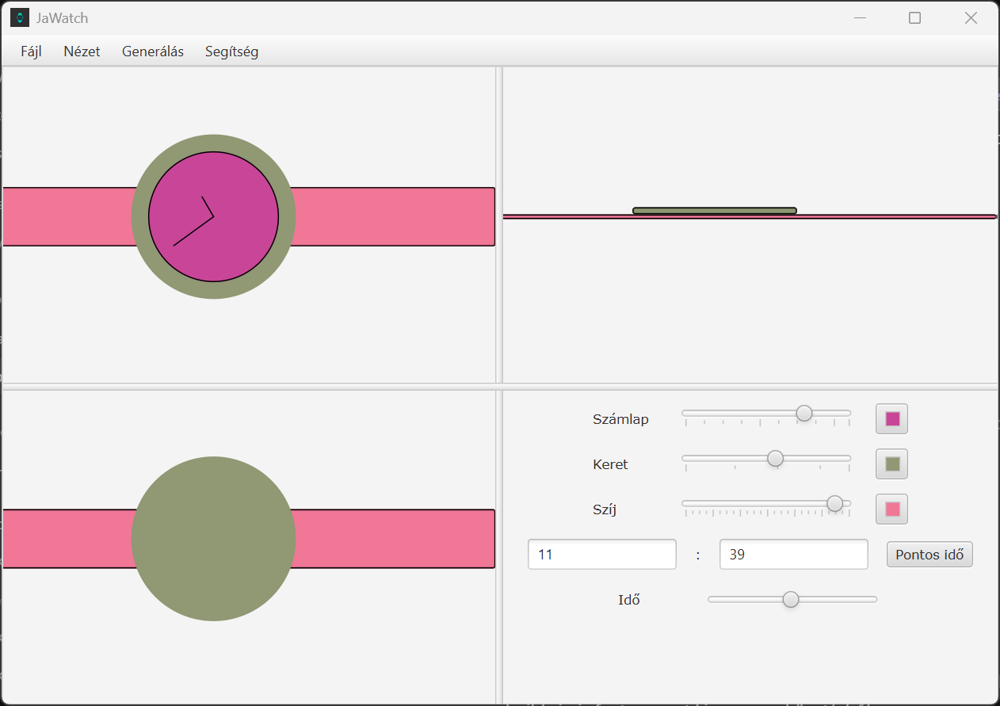

# JaWatch

Grafikus Java program, amivel karórát lehet összeállítani és megnézni három nézetből. A Széchenyi István Egyetem programtervező informatikus BSc Objektumorientált programozás tárgyának beadandója.

Készítők: Hunyadvári Ádám Radó, Kazda Adrián Zsolt.



## Mit lehet vele csinálni

A számlap sugarát és színét, a keret vastagságát és színét, valamint a szíj hosszát és színét csúszkával és színválasztóval lehet állítani. Az időt óra és perc mezőben, vagy az idő csúszkán lehet megadni. A Pontos idő gomb a rendszeridőre állítja a mutatókat.

Négy panel van:

- bal felső: felsőnézet, mutatókkal
- jobb felső: oldalnézet
- bal alsó: alsónézet
- jobb alsó: a beállítások

A Fájl menüben a kész órát `.ora` fájlba lehet menteni, vissza lehet tölteni, és törölni is lehet. Három minta van a `src/main/saved` mappában: `example1.ora`, `example2.ora`, `example3.ora`. A törlés párbeszédablaka alapból ide nyílik.

A Generálás menü véletlen színt, véletlen formát, vagy mindkettőt tud húzni. A Nézet menüben a panelekre lehet ugrani, a méreteket ki-be lehet kapcsolni, és a nézet nagyítását vissza lehet állítani.

| Menü | Gyorsgomb | Mit csinál |
| --- | --- | --- |
| Fájl | Ctrl+S, Ctrl+O | mentés, megnyitás |
| Nézet | F1, F2, F3 | felső, oldal, alsó nézet |
| Nézet | T, R, M | pontos idő, nézet visszaállítása, méretek |
| Generálás | C, F, Szóköz | szín, forma, minden |
| Segítség | H, K | súgó, gyorsgombok |

## Futtatás

Java 21 kell. JavaFX-et a Maven tölti le, külön telepíteni nem kell.

Windows, a projekt mappájából:

```bat
.\mvnw.cmd javafx:run
```

A wrapper első indításkor letölti a Mavent, utána a program ablakot nyit. Ha a `java` parancs nem található, a JDK `bin` mappájának rajta kell lennie a PATH-on, és a `JAVA_HOME` a JDK gyökerére mutasson.
